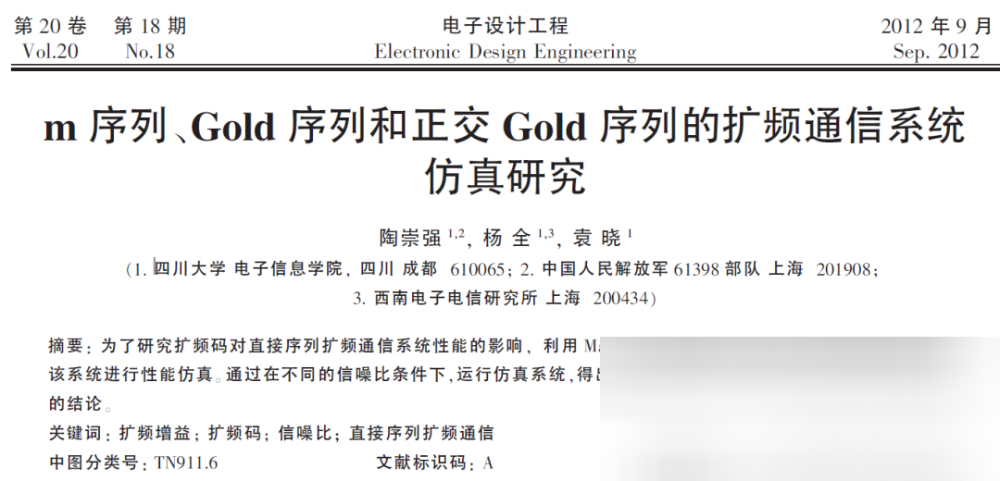
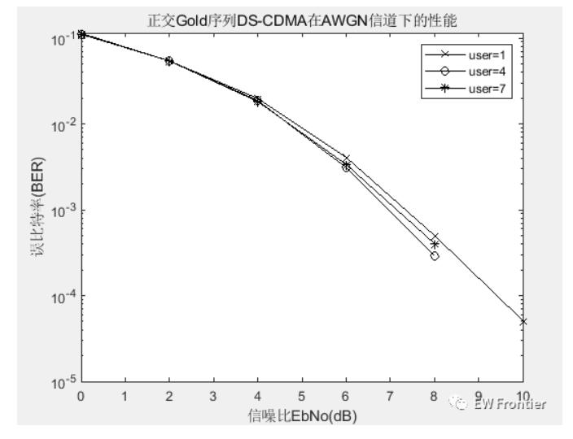
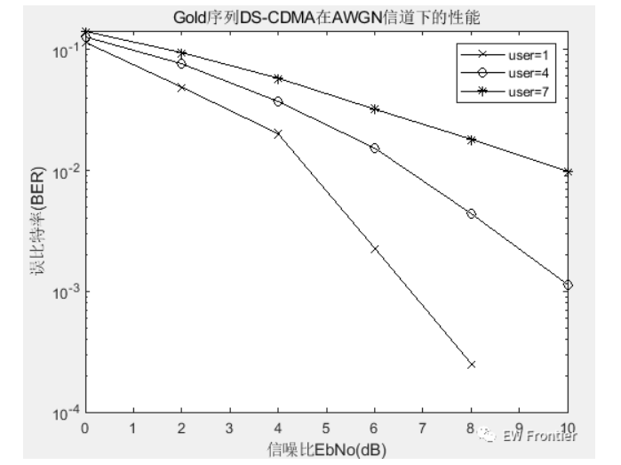
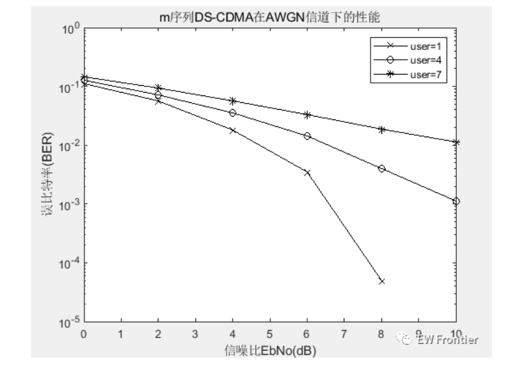

# Spread Spectrum Communication: Multi-User DS-CDMA Spread Spectrum Communication System Simulation with M-sequence, Gold sequence, and Positive-Quadrature Gold sequence

MATLAB simulation results:
\n        \n      \n        \n      \n        \n  
More radar and communication MATLAB codes
%%1-m;2-Gold;3-Orthogonal Gold Sequence DS-CDMA Performance Simulation under AWGN Channel\nclear all\nclose all\nuser=[1 4 7];\nseq=1;  %1-m;2-Gold;3-Orthogonal Gold\nfor index=1:length(user)\n    ber(index,:)=dscdma(user(index),seq);\nend\n\nEbNo=0:2:10;\nsemilogy(EbNo,ber(1,:),'-kx',EbNo,ber(2,:),'-ko',EbNo,ber(3,:),'-k*');\nlegend('user=1','user=4','user=7')\ntitle('mSequenceDS-CDMAInAWGNPerformance under channel')\nxlabel('Signal-to-noise ratioEbNo(dB)')\nylabel('Error bit rate(BER)')\n  

## Images

<!-- PAYMENT_BLOCK -->

## Get this dataset

- Payment link (Stripe): [Buy now](https://buy.stripe.com/3cs8yP7sY87d0vu9AB)
- Payment QR code: 

<!-- /PAYMENT_BLOCK -->
